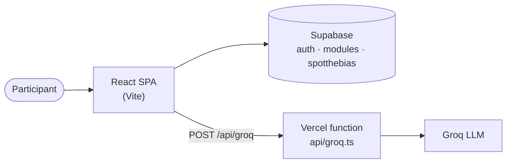

# AskWhy

An interactive workshop that teaches people how social feeds narrow what they see, and how to step outside that bubble. Users build a mock feed from their interests, then work through short exercises on bias, misinformation and opposing views.

**Live:** https://askwhy.vercel.app

## Why we built it

Recommendation feeds show people more of what they already engage with, and over time that hides the other side of most stories. Explaining filter bubbles in a lecture doesn't land. Letting people experience one, then practise spotting and breaking it, does.

## Features

The workshop runs in three phases:

| Phase | Exercises |
|---|---|
| **I: Awareness** | **Pick & Flick:** build your own newsfeed from five interests. **Behind the Buzz:** trace how one post spreads and gets amplified. |
| **II: Logical reasoning** | **Fake or Fact?:** judge headlines and posts. **Spot the Bias:** find the slant in a piece of content. |
| **III: Accepting diversity** | **Debate Switch:** argue against an AI opponent, then switch sides. **In Their Shoes:** step into another person's perspective. |

- Login and onboarding, with workshop modules and exercise content stored in Supabase.
- The debate opponent runs on Groq (`llama-3.1-8b-instant`) through a serverless function, so the API key never reaches the browser.

## Tech stack

React 18, TypeScript, Vite, Tailwind CSS, shadcn/ui (Radix), GSAP animations, Redux Toolkit, Supabase (auth and Postgres), Groq, Vercel (static site and `api/` functions).



## Getting started

**Prerequisites:** Node 20. For the debate exercise, a Groq API key and the [Vercel CLI](https://vercel.com/docs/cli).

```bash
npm install --legacy-peer-deps
npm run dev            # http://localhost:8080. Everything except the AI debate works.
```

To run the AI debate locally, serve the `api/` function too:

```bash
cp .env.example .env   # set GROQ_API_KEY
vercel dev
```

`npm run build` creates the production bundle, and `npm run lint` runs ESLint.

## Challenges and what we learned

- **Never call an LLM from the browser with a real key.** The first version did, so the key ended up in the public bundle. Moving the call into `api/groq.ts`, with an allow-listed model and a capped `max_tokens`, fixed the leak without turning the function into an open proxy.

## Limitations and roadmap

- There are leftover duplicate pages (`Index-copy.tsx`, `Indexcopy.tsx`, `NotFoundcopy.tsx`, `NotFound-copy2.tsx`, `check imp.tsX`) and unused routes to clean up.
- The debate topic is fixed in code. Topics could come from the `modules` table so facilitators can change them.
- There are no automated tests yet.

## Contributors

Muddasir Rizwan, with contributions from Iliyan, Owais Bin Asad and Goheer.

## License

All rights reserved by the contributors listed above.
